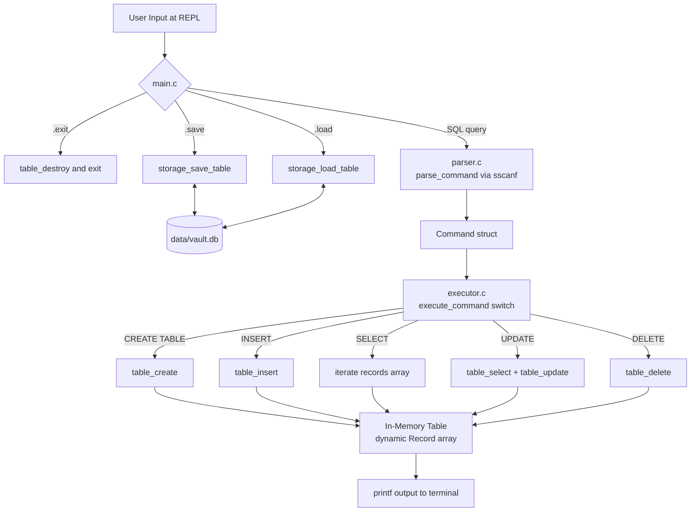
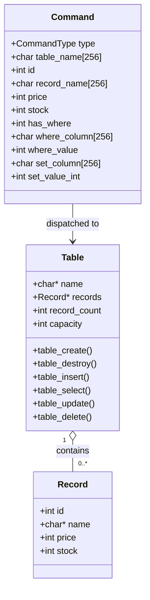
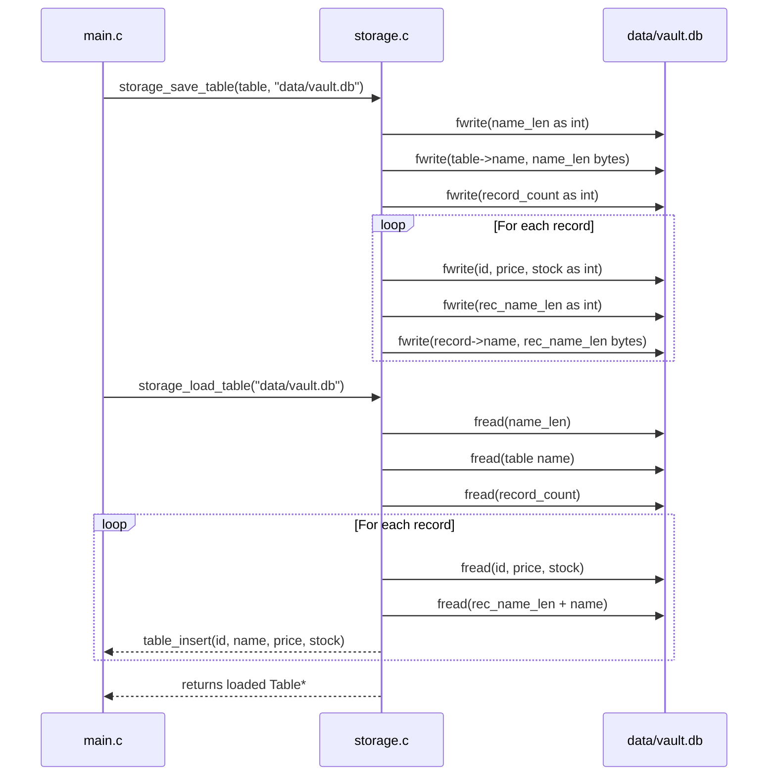

# VaultDB

### A Lightweight Embedded Database Engine Built from Scratch in C

VaultDB is a minimal, offline-first relational database engine implemented entirely in C11 with no external dependencies. It provides an interactive command-line REPL that accepts a subset of SQL syntax to create, query, and persist tabular data to disk in a custom binary format.

---

## Demo Video

[Add your project demo video link here]

---

## Description

VaultDB was built as a ground-up implementation of the core concepts behind a relational database: structured record storage, SQL-like query parsing, in-memory CRUD operations, and binary file persistence. Every component — the data structures, query parser, storage engine, and interactive shell — was written by hand without any third-party database library.

The engine holds one table in memory at a time. Each record in that table has four fixed fields: an integer ID, a string name, an integer price, and an integer stock count. Data can be saved to and loaded from a custom binary `.db` file between sessions.

---

## Features

- Interactive REPL with a `vaultdb>` prompt
- SQL-like commands: `CREATE TABLE`, `INSERT`, `SELECT`, `UPDATE`, `DELETE`
- Dynamic array that grows automatically as records are inserted (`realloc`-based)
- Binary file persistence via `.save` and `.load` meta-commands
- Structured memory ownership with no leaks at shutdown
- Safe `.load` that preserves the in-memory table on a failed load attempt
- All `fwrite` return values checked to detect disk-full errors
- Compiles to a single self-contained binary with no runtime dependencies

---

## Tech Stack

| Layer | Technology |
|---|---|
| Language | C11 |
| Compiler | GCC |
| Build System | GNU Make |
| Standard Library | `stdio.h`, `stdlib.h`, `string.h` |
| Storage Format | Custom binary (raw integer and length-prefixed string writes via `fwrite`/`fread`) |
| Parser Strategy | Pattern matching via `sscanf` |

---

## Architecture

VaultDB is organized into five modules with well-defined responsibilities. Data flows in one direction: user input is read by `main`, parsed into a `Command` struct, dispatched by the executor, and applied to the in-memory table. Persistence is handled as a side channel through meta-commands.



### Module Responsibilities

| Module | Files | Role |
|---|---|---|
| Shell / REPL | `src/main.c` | Reads input, handles meta-commands, owns the `active_table` pointer |
| Parser | `src/parser.c`, `include/parser.h` | Converts raw input strings into a typed `Command` struct using `sscanf` |
| Executor | `src/executor.c`, `include/executor.h` | Dispatches a `Command` to the appropriate `table.c` function |
| Table | `src/table.c`, `include/table.h` | Manages the dynamic array of `Record` structs in memory |
| Record | `src/record.c`, `include/record.h` | Defines the `Record` struct; provides standalone create/destroy helpers |
| Storage | `src/storage.c`, `include/storage.h` | Serializes and deserializes the table to and from a binary file |

---

## Data Structures



The `Table` struct holds a heap-allocated `Record` array. When the array is full, `table_insert` calls `realloc` to double the capacity. Record name strings are individually heap-allocated and owned by the array. `table_destroy` frees in innermost-to-outermost order to avoid use-after-free.

---

## Folder Structure

```
VaultDB/
├── Makefile                  Build instructions for gcc
├── README.md                 This file
├── PROJECT_GUIDE.md          Development roadmap used during construction
├── data/
│   └── vault.db              Binary database file created by .save
├── include/                  Header files (declarations only)
│   ├── record.h              Record struct and record_create/record_destroy
│   ├── table.h               Table struct and all CRUD function declarations
│   ├── storage.h             storage_save_table and storage_load_table
│   ├── parser.h              Command struct, CommandType enum, parse_command
│   └── executor.h            execute_command declaration
├── src/                      Source files (all implementation)
│   ├── main.c                Entry point; REPL loop and meta-command handling
│   ├── record.c              Standalone record allocation helpers
│   ├── table.c               Dynamic array management and all CRUD operations
│   ├── storage.c             Binary file save and load with error checking
│   ├── parser.c              sscanf-based SQL pattern matching
│   └── executor.c            Command dispatch via switch statement
└── tests/
    └── .gitkeep              Reserved for future unit tests
```

---

## Installation and Setup

### Prerequisites

- GCC (any version supporting C11)
- GNU Make

### Build

```bash
git clone <repository-url>
cd VaultDB
make
```

This compiles all six source files with strict warning flags and produces the `vaultdb` binary in the project root.

```bash
# To remove the compiled binary
make clean
```

### Compiler Flags

| Flag | Purpose |
|---|---|
| `-Wall` | Enables all common warnings |
| `-Wextra` | Enables additional diagnostics beyond `-Wall` |
| `-Wpedantic` | Enforces strict ISO C11 compliance |
| `-std=c11` | Targets the C11 standard |
| `-Iinclude` | Adds `include/` to the header search path |

---

## Usage

```bash
./vaultdb
```

The shell starts and displays the `vaultdb>` prompt. All SQL commands are case-sensitive and require a trailing semicolon. Meta-commands begin with a dot and do not use a semicolon.

### Supported Commands

| Command | Syntax | Description |
|---|---|---|
| CREATE TABLE | `CREATE TABLE products;` | Creates a new empty table in memory |
| INSERT | `INSERT INTO products VALUES (1, "Keyboard", 1200, 10);` | Inserts a record with id, name, price, stock |
| SELECT | `SELECT * FROM products;` | Prints all records in tabular form |
| UPDATE price | `UPDATE products SET price = 999 WHERE id = 1;` | Updates the price field of the record with the given id |
| UPDATE stock | `UPDATE products SET stock = 5 WHERE id = 1;` | Updates the stock field of the record with the given id |
| DELETE | `DELETE FROM products WHERE id = 1;` | Deletes the record with the given id |
| .save | `.save` | Saves the current table to `data/vault.db` |
| .load | `.load` | Loads a table from `data/vault.db` into memory |
| .exit | `.exit` | Frees all memory and exits the program |

### Example Session

```
VaultDB version 1.0. Type .exit to quit.
vaultdb> CREATE TABLE products;
Created table.
vaultdb> INSERT INTO products VALUES (1, "Keyboard", 1200, 10);
Inserted 1 row.
vaultdb> INSERT INTO products VALUES (2, "Mouse", 500, 25);
Inserted 1 row.
vaultdb> SELECT * FROM products;
ID  | Name       | Price | Stock
--------------------------------
1   | Keyboard   | 1200  | 10   
2   | Mouse      | 500   | 25   
vaultdb> UPDATE products SET price = 999 WHERE id = 1;
Updated price.
vaultdb> DELETE FROM products WHERE id = 2;
Deleted 1 row.
vaultdb> .save
Saved to data/vault.db
vaultdb> .exit
```

---

## Binary Storage Format

The `.db` file written by `.save` uses a custom length-prefixed binary format. It is not human-readable and is not portable across platforms with different integer sizes.



---

## Known Limitations

- The parser is case-sensitive. `create table` is not recognized; only `CREATE TABLE` works.
- Only one table can be active in memory at a time. `CREATE TABLE` replaces the current table.
- `SELECT` does not support a `WHERE` clause; it always returns all records.
- `UPDATE` only supports the `price` and `stock` columns.
- `DELETE` and `UPDATE` only match by integer `id`.
- Duplicate IDs are not detected on insert.
- The storage format uses raw `int` bytes and is not portable across platforms with different integer sizes.
- The `tests/` directory is empty; correctness has been verified through manual REPL interaction only.

---

## Memory Management

All heap memory is owned by the `Table` struct and freed in innermost-to-outermost order inside `table_destroy`:

1. Each `records[i].name` string
2. The `records` array block
3. The `table->name` string
4. The `Table` struct itself

Temporary buffers allocated during `.load` (for table name and record name strings read from the file) are freed immediately after being copied into the table. The program exits with zero memory leaks under normal operation.

